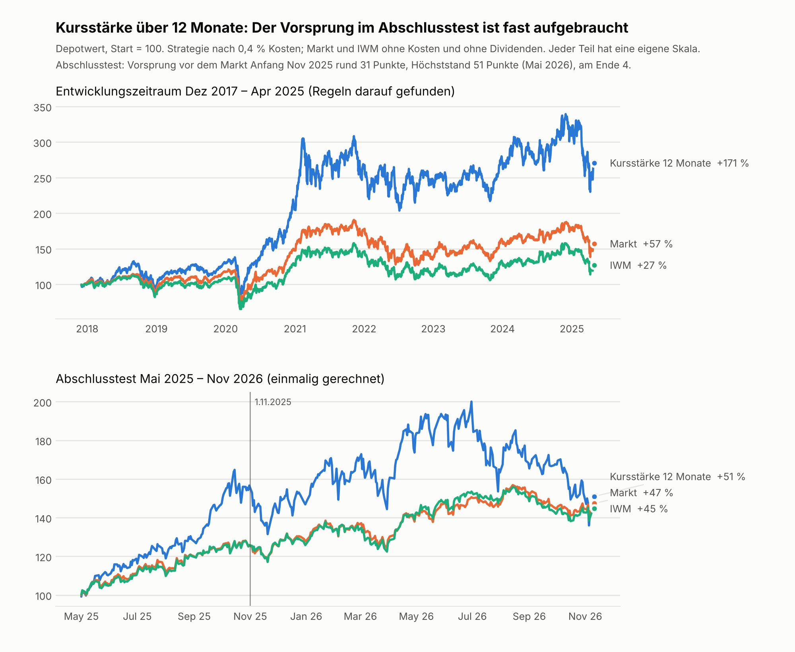

# Strategiesuche: Gibt es eine regelbasierte US-Aktienauswahl, die den Markt nach Kosten schlägt?

Stand: 13. November 2026. Alle Zahlen stammen aus `strategie.py`, `output/strategie_ergebnisse.json` und `output/abschlusstest.json`.

## Ergebnis in Kürze

- **Von 14 geprüften Varianten (7 Hypothesen) hat genau eine den Entwicklungszeitraum bestanden:** Kursstärke über 12 Monate (1a). Alle anderen 13 sind durchgefallen.
- **Im einmaligen Abschlusstest** (1.5.2025 bis 11.11.2026, 19 Monate) lag 1a nach 0,4 % Kosten bei +51,0 %, der Markt bei +47,4 %, IWM bei +44,6 %. Nach der Regel formal bestanden.
- **Belastbar ist das nicht.** Der Vorsprung beträgt 3,6 Punkte in 19 Monaten (Zufall schwankt um ±2 Punkte pro Jahr), verschwindet bei 1,0 % Kosten (+45,5 % gegen Markt +47,4 %) und stammt aus Mai bis Oktober 2025. Seit November 2025 lief die Strategie deutlich hinter dem Markt.
- **Empfehlung: kein Geld auf diese Strategie.** Ein ehrliches „nichts Belastbares gefunden“ ist das Ergebnis.

Tabellenansicht der Kurven: `output/depotkurve.csv`.

## So wurde geprüft

- Monatlich alle handelbaren Aktien (Kurs ≥ 3 $, 20-Tage-Umsatz ≥ 1 Mio. $) nach einer Kennzahl ordnen, die besten 10 % kaufen, gleich gewichten, immer voll investiert. Kauf zur Eröffnung des Folgetags.
- Kosten 0,4 % für Kauf und Verkauf zusammen, zusätzlich eine Rechnung mit 1,0 %.
- Vergleich: Durchschnitt der handelbaren Aktien und IWM, beide voll investiert, ohne Kosten.
- Entwicklung Dezember 2017 bis April 2025 (89 Monate, 15 Halbjahre), Abschlusstest ab Mai 2025, je Strategie genau einmal. Hypothesen vorher festgeschrieben (Commit „Hypothesenliste vor der ersten Rechnung festgeschrieben“).
- Bilanzdaten zählen erst ab ihrem Meldedatum (SEC `filed`), nur Erstmeldungen.
- Bestanden heißt im Entwicklungszeitraum: in mindestens 10 von 15 Halbjahren vor Markt **und** IWM, und auch ohne die drei besten Aktien je Halbjahr noch vor dem Markt.

### Prüfung des Rücktests selbst (`output/selbsttest.md`)

- Zufallsauswahl landet beim Markt (+6,2 bis +6,3 % pro Jahr gegen +6,3 %, 500 Läufe, 90 % der Läufe zwischen +4,2 und +8,5 %).
- Auswahl mit Zukunftswissen ist unrealistisch gut (+1.365 % pro Jahr; mit nur einem Tag Vorsprung +68 %), dieselbe Kennzahl ohne Vorsprung bringt 0 %.
- Die Regel „ohne die 3 besten“ kostet allein rund 4 Punkte pro Jahr. Reiner Zufall besteht die Hürden in höchstens 0,8 % der Läufe.

## Alle geprüften Varianten (Entwicklungszeitraum)

Markt +6,3 % pro Jahr, IWM +3,3 % pro Jahr (beide ohne Dividenden).

| Variante | Grund (vorher festgelegt) | Aktien | pro Jahr nach 0,4 % | nach 1,0 % | Halbjahre vor beiden (nötig 10) | ohne 3 beste pro Jahr | Urteil |
|---|---|---|---|---|---|---|---|
| 1a Kursstärke 12 Monate | Anleger reagieren zu langsam, Trends laufen weiter | 175 | +14,4 % | +11,8 % | 10 von 15 | +8,0 % | bestanden |
| 1b Kursstärke 6 Monate | wie 1a, kürzerer Zeitraum | 175 | +12,4 % | +8,8 % | 7 von 15 | +5,7 % | durchgefallen |
| 2a Kursstärke, profitabel, Aktienzahl ≤ +2 % | Trends bei Verlustfirmen und Verwässerern brechen öfter ab | 86 | +9,1 % | +6,5 % | 8 von 15 | +4,3 % | durchgefallen |
| 2b Kursstärke, profitabel, Aktienzahl ≤ 0 % | wie 2a, strenger | 49 | +8,0 % | +5,2 % | 8 von 15 | +1,9 % | durchgefallen |
| 3a Nähe zum 52-Wochen-Hoch, beste 10 % | Anleger zögern bei alten Höchstkursen | 175 | +6,4 % | +1,5 % | 7 von 15 | +3,3 % | durchgefallen |
| 3b Nähe zum 52-Wochen-Hoch, beste 20 % | wie 3a, breiter | 351 | +7,2 % | +3,9 % | 7 von 15 | +5,3 % | durchgefallen |
| 4a Profitabel und günstig | gute Firmen zu niedrigen Preisen werden unterschätzt | 129 | +5,3 % | +4,1 % | 3 von 15 | +2,3 % | durchgefallen |
| 4b Profitabel und günstig, Kurs im Plus | wie 4a, nur bei steigendem Kurs | 74 | +4,2 % | +1,8 % | 6 von 15 | -0,4 % | durchgefallen |
| 5a Beschleunigung | der Markt unterschätzt Wendepunkte im Wachstum | 140 | +10,9 % | +8,1 % | 11 von 15 | +5,0 % | durchgefallen |
| 5b Beschleunigung, profitabel | wie 5a, nur profitable Firmen | 102 | +7,1 % | +4,3 % | 5 von 15 | +2,2 % | durchgefallen |
| 6a Stärkster Rückgang der Aktienzahl | Rückkäufe zeigen Geld und Vertrauen | 144 | +10,4 % | +9,3 % | 8 von 15 | +6,0 % | durchgefallen |
| 6b Rückkäufe ≥ 1 %, profitabel | wie 6a, als Filter | 335 | +8,6 % | +7,8 % | 7 von 15 | +7,3 % | durchgefallen |
| 7a Ausschlussliste | Verlierer meiden ist leichter als Gewinner finden | 1070 | +7,2 % | +6,6 % | 7 von 15 | +6,3 % | durchgefallen |
| 7b Ausschlussliste, ohne alle Verlustfirmen | wie 7a, strenger | 966 | +6,6 % | +6,1 % | 6 von 15 | +5,8 % | durchgefallen |

Nicht gerechnet, weil kein sauberer Test mehr möglich ist: „A+ als Beimischung“ und der „Meiden“-Teil der Ausschlussliste. Beide Regeln wurden an Daten bis November 2026 gefunden, der Abschlusszeitraum ist für sie also verbraucht. Sie laufen nur im wöchentlichen Probelauf ohne Geld weiter.

## Abschlusstest für 1a im Detail

| Zeitraum | Strategie | Markt | IWM |
|---|---|---|---|
| Halbjahr ab 2025-05 | +56,5 % | +25,6 % | +25,8 % |
| Halbjahr ab 2025-11 | +16,3 % | +12,7 % | +13,2 % |
| Halbjahr ab 2026-05 | -15,6 % | +2,9 % | +1,1 % |
| Halbjahr ab 2026-11 | -1,7 % | +1,1 % | +0,5 % |
| **gesamt (19 Monate)** | **+51,0 %** | **+47,4 %** | **+44,6 %** |
| gesamt mit 1,0 % Kosten | +45,5 % | | |

Das Halbjahr ab November 2026 enthält nur die ersten Tage (bis 11.11.2026). Größter Rückgang der Strategie im Abschlusstest -32 %.

## Warum ich der bestandenen Variante nicht traue

1. **Zu knapp.** 3,6 Punkte Vorsprung in 19 Monaten liegen im Rauschen der Zufallsauswahl.
2. **Kosten.** Mit 1,0 % Kosten (realistisch für kleine, wenig gehandelte Aktien) liegt sie hinter dem Markt.
3. **Ein einziges gutes Halbjahr.** Mai bis Oktober 2025 liefert den ganzen Vorsprung. Im Halbjahr ab Mai 2026 verlor die Strategie 15,6 %, der Markt gewann 2,9 %.
4. **Gleiches Muster im Entwicklungszeitraum.** Der Vorsprung stammt dort vor allem aus 2020 bis 2022, in den letzten fünf Halbjahren war er kaum noch vorhanden. Typisch für einen Effekt, der verschwindet, sobald ihn viele nutzen.
5. **Momentum-Rückschläge sind bekannt.** Aktien, die stark gestiegen sind, fallen bei einer Marktwende oft gemeinsam und stark. Der größte Rückgang im Abschlusstest lag bei −32 %.

## Grenzen der Daten

- **Überlebensverzerrung.** Das Universum sind heute gelistete Aktien ab 100 Mio. $ Börsenwert. Pleiten und Übernahmen fehlen. Das begünstigt vor allem Kursstärke, die echten Ergebnisse waren schlechter. Wie viel, ist mit diesen Daten nicht messbar. Im 19-Monats-Abschlusstest ist die Verzerrung klein.
- **Dividenden fehlen** bei Strategie, Markt, IWM und SPY. Der Vergleich bleibt fair, die absoluten Renditen sind zu niedrig.
- **Abdeckung der Bilanzdaten:** 79 % der handelbaren Aktien (2.500 von 2.831 Aktien sind der SEC zugeordnet; ausländische Firmen fehlen weitgehend). Die Bilanz-Varianten liefen nur auf dieser Teilmenge, die im Durchschnitt +6,9 % statt +6,3 % pro Jahr brachte.
- **Kurzer Zeitraum.** Zehn Jahre Kurse, davon 7,4 Jahre Entwicklung. 15 Halbjahre sind wenig, um zu unterscheiden, ob ein Vorsprung echt ist.
- **Datenfehler** wurden bereinigt (11 Kursausreißer, 14 Niveausprünge, Aktienzahlen mit Gegenprobe). Echte Kursstürze blieben drin.
- **Mehrfachtest.** 14 Varianten wurden gerechnet; unter so vielen besteht eine auch per Zufall einmal. Im Selbsttest besteht reiner Zufall die Hürden in höchstens 0,8 % der Läufe, bei 14 Versuchen also gelegentlich.

## Was daraus folgt

- Diese Suche hat keine Strategie gefunden, mit der ich Geld riskieren würde.
- Gelernt: Einfache Bilanzkennzahlen (günstig, profitabel, Wachstum, Rückkäufe) schlagen den Markt hier nicht. Reine Kursstärke über 12 Monate hatte zeitweise einen Vorsprung, der aber instabil ist.
- Nicht tun: 1a nachbessern oder den Abschlusstest wiederholen. Die Daten ab Mai 2025 sind jetzt verbraucht; jede neue Hypothese braucht einen neuen, bisher ungesehenen Zeitraum (also abwarten, bis neue Monate vorliegen) oder andere Märkte.
- Weiter sinnvoll: der wöchentliche Probelauf ohne Geld für A, A+ und Meiden läuft weiter und liefert echte Zukunftsdaten.
